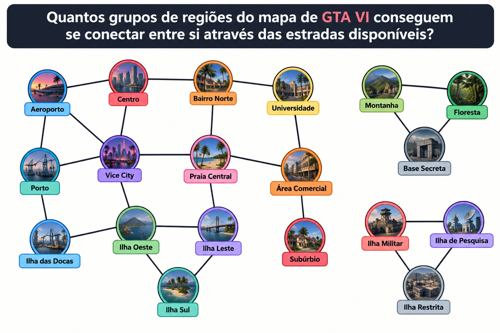

# Componentes Conexos em Grafos

Projeto desenvolvido para a AV2 da disciplina de Grafos.

## Tema

Componentes conexos utilizando Busca em Profundidade (DFS).

## Situação-problema

O problema simula regiões de um mapa inspirado em GTA VI.

Cada região é representada por um vértice e cada estrada disponível entre duas regiões é representada por uma aresta.

O objetivo é identificar quantos grupos de regiões conseguem se conectar entre si.



## Algoritmo

Foi utilizada a Busca em Profundidade (DFS) para percorrer todos os vértices conectados.

Sempre que é encontrado um vértice ainda não visitado, uma nova DFS é iniciada, indicando um novo componente conexo.

## Requisitos

- Python 3

Não é necessária nenhuma biblioteca externa.

## Como executar

Abra o terminal na pasta do projeto e execute:

```bash
python main.py
```


## Integrantes

- Caio Gabriel 
- Ricardo Santos
- Heitor
